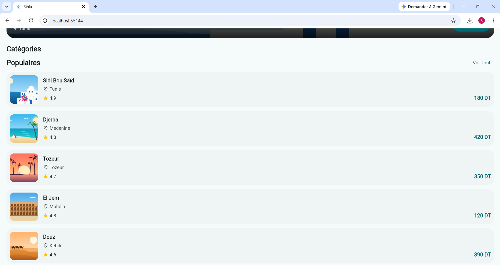
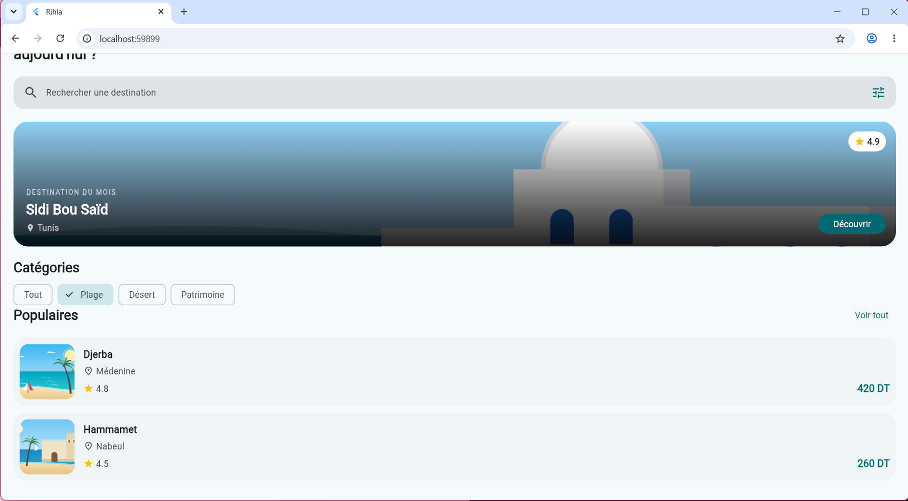
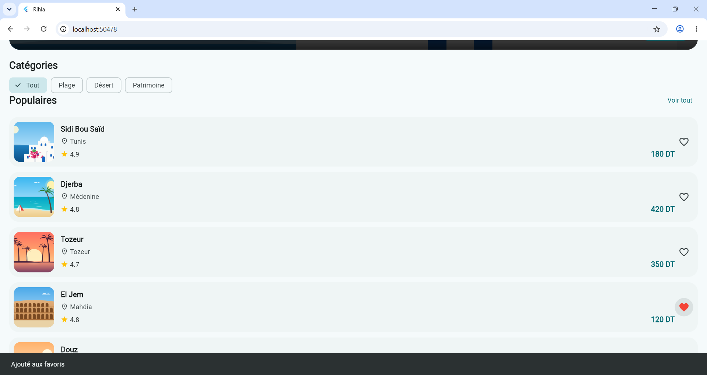
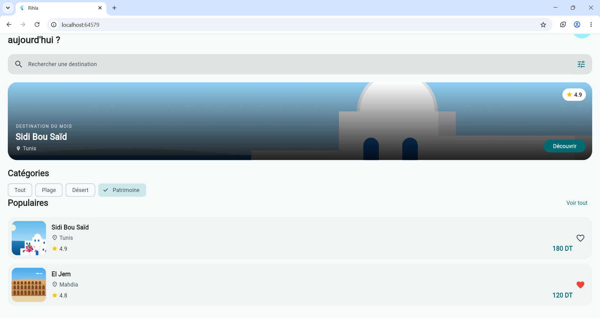

# rihla

A new Flutter project.

## Getting Started

This project is a starting point for a Flutter application.

A few resources to get you started if this is your first Flutter project:

- [Learn Flutter](https://docs.flutter.dev/get-started/learn-flutter)
- [Write your first Flutter app](https://docs.flutter.dev/get-started/codelab)
- [Flutter learning resources](https://docs.flutter.dev/reference/learning-resources)

For help getting started with Flutter development, view the
[online documentation](https://docs.flutter.dev/), which offers tutorials,
samples, guidance on mobile development, and a full API reference.
## Questions de compréhension (palier 2):

# Q1. Sans Expanded, où se place l'avatar ?
L'avatar se place juste après le texte. Avec Expanded, il se place à droite

# Q2. Pourquoi prenom est final ?
Parce que sa valeur ne change pas

# Q3. Différence entre cs.primary et Colors.teal ?
cs.primary change avec le theme. Colors.teal reste toujours la meme couleur

## capture de resultat (palier 2):

## Questions de compréhension (palier 3):

# Q4. Pourquoi placer DecoratedBox en premier ?
Le degrade sera cache par l'image et le texte sera difficile a lire

# Q5. Que se passe-t-il si on retire ClipRRect ?
Les coins arrondis disparaissent

# Q6. Pourquoi right: 130 dans Positioned ?
Pour laisser de la place au bouton Decouvrir 

## capture de resultat (palier 3):

## Questions de compréhension (palier 4):

# Q7.	Pourquoi la Row « note / prix » a-t-elle besoin que la Column soit dans un Expanded pour que Spacer fonctionne ?
Expanded donne toute la place disponible à la Column. Spacer pousse alors le prix a droite.

# Q8.	Combien de lignes faudrait-il ajouter pour afficher une 7e destination ? Dans quel fichier ?
Ajouter une ligne dans lib/data/destinations.dart. La nouvelle destination s'affiche automatiquement.

## capture de resultat (palier 4):

## Questions de compréhension (palier 5):

# Q9. Écrivez _categorie = c; sans setState. Que se passe-t-il à l'écran ? Et en mémoire ?
La valeur de _categorie change en memoire, mais l'ecran ne se met pas a jour automatiquement

# Q10. Pourquoi _filtrees est-il un getter recalculé à chaque build() plutôt qu'une variable ?
Le getter recalcule les destinations selon la categorie choisie a chaque build(), pour afficher les bons resultats

# Q11. Pourquoi HeroBanner peut-il rester un StatelessWidget alors que l'écran change ?
Parce qu'il n'a pas d'etat qui change. Il affiche simplement la destination recue en parametre

## capture de resultat (palier 5):

## Explication de l'exercice (palier 6):
Sans ValueKey, Flutter peut associer un favori a la mauvaise destination apres un filtrage. Avec ValueKey(d.nom), chaque carte garde son propre favori, meme si la liste change

## captures de resultat (palier 6):

