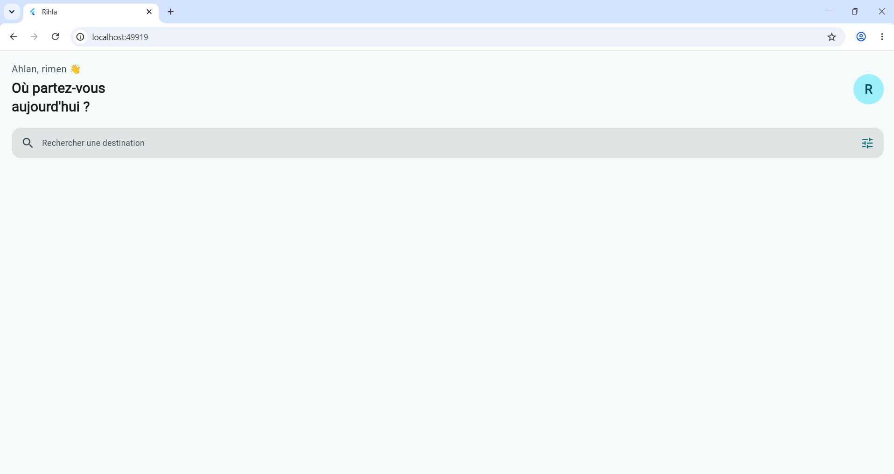
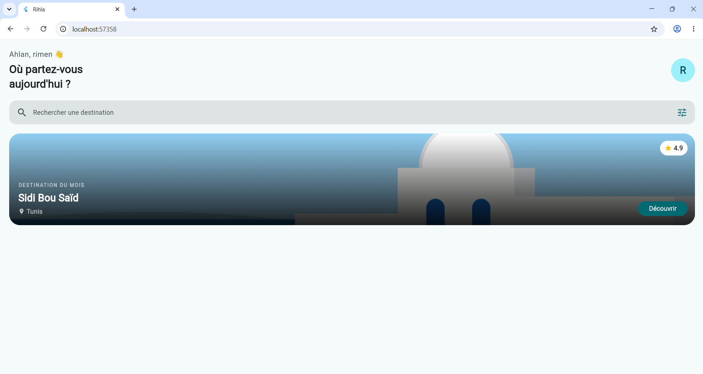

# rihla

A new Flutter project.

## Getting Started

This project is a starting point for a Flutter application.

A few resources to get you started if this is your first Flutter project:

- [Learn Flutter](https://docs.flutter.dev/get-started/learn-flutter)
- [Write your first Flutter app](https://docs.flutter.dev/get-started/codelab)
- [Flutter learning resources](https://docs.flutter.dev/reference/learning-resources)

For help getting started with Flutter development, view the
[online documentation](https://docs.flutter.dev/), which offers tutorials,
samples, guidance on mobile development, and a full API reference.
## Questions de compréhension (palier 2):

# Q1. Sans Expanded, où se place l'avatar ?
L'avatar se place juste après le texte. Avec Expanded, il se place à droite

# Q2. Pourquoi prenom est final ?
Parce que sa valeur ne change pas

# Q3. Différence entre cs.primary et Colors.teal ?
cs.primary change avec le theme. Colors.teal reste toujours la meme couleur

## capture de resultat (palier 2):

## Questions de compréhension (palier 2):

# Q4. Pourquoi placer DecoratedBox en premier ?
Le degrade sera cache par l'image et le texte sera difficile a lire

# Q5. Que se passe-t-il si on retire ClipRRect ?
Les coins arrondis disparaissent

# Q6. Pourquoi right: 130 dans Positioned ?
Pour laisser de la place au bouton Decouvrir 

## capture de resultat (palier 3):
